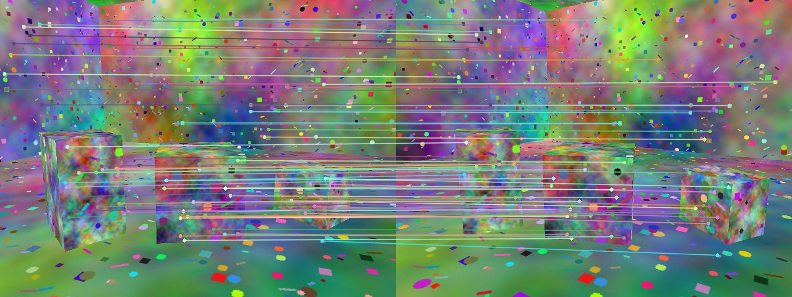
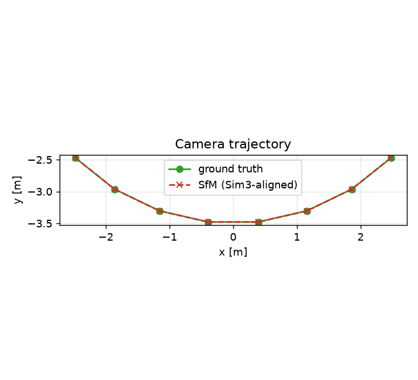
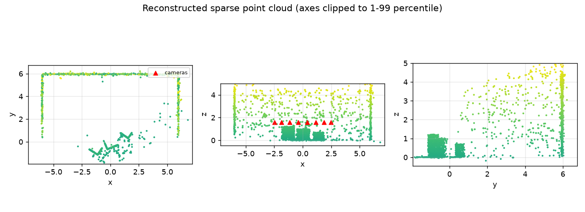

# multiview-sfm-pointcloud

A from-scratch-where-it-matters **structure-from-motion (SfM) pipeline**: from a set of images to camera poses, a sparse 3D point cloud and a surface mesh, evaluated against exact ground truth.

```
images -> SIFT/ORB features -> ratio-test matching -> epipolar verification (essential matrix, RANSAC)
       -> tracks -> two-view initialisation -> PnP registration + triangulation (incremental)
       -> sparse bundle adjustment -> Open3D cloud cleaning, plane RANSAC, normals, Poisson mesh
       -> Sim(3) alignment to ground truth -> metrics + figures
```

## Why this exists

Reconstructing 3D geometry from several camera views is the core of automotive perception (surround-view cameras, mapping, calibration checks, multi-camera 3D reconstruction) and of AR/robotics (localisation, scene capture). The same few ideas show up everywhere: epipolar geometry, triangulation, PnP and bundle adjustment. This repository implements them end to end so that every step is inspectable and checked against a known answer.

Because the data is **synthetic and rendered in code**, every claim below can be verified: camera poses, 3D structure and depth are known exactly.

## What is implemented

| Area | Where | Notes |
|---|---|---|
| Pinhole camera, poses, orbit generator | `sfm/camera.py` | OpenCV conventions, `x_cam = R X + t` |
| Synthetic data | `sfm/synthetic.py` | (a) random 3D points with noisy pixel observations and outliers; (b) a ray-cast textured room with boxes: real images plus exact depth maps and exact distance-to-surface |
| Epipolar geometry in plain numpy | `sfm/geometry.py` | normalised 8-point algorithm, essential-manifold projection, Sampson error, RANSAC around the 8-point, `E` decomposition (4 hypotheses), cheirality, DLT triangulation (two-view and multi-view), Sampson pose refinement |
| Features and matching | `sfm/features.py` | SIFT or ORB, Lowe ratio test, mutual nearest neighbour |
| Two-view pipeline (OpenCV) | `sfm/two_view.py` | `findEssentialMat` (RANSAC) -> `recoverPose` -> Sampson polish -> triangulation -> cheirality / reprojection / parallax filters |
| Incremental SfM | `sfm/sfm.py` | union-find tracks, best-pair initialisation, `solvePnPRansac` + LM refinement, multi-view triangulation, optional BA after each view, observation pruning |
| Bundle adjustment | `sfm/bundle_adjustment.py` | `scipy.optimize.least_squares`, sparse Jacobian pattern, robust losses, gauge fixed by freezing camera 0 |
| Point clouds and meshes | `sfm/cloud.py` | Open3D: statistical outlier removal, voxel downsampling, PCA normals oriented to the cameras, RANSAC plane segmentation (single and multi-plane), Poisson and ball-pivoting meshes, PLY/OBJ export |
| Evaluation | `sfm/evaluate.py` | Umeyama Sim(3) alignment, absolute trajectory error, rotation errors, exact point-to-surface distance |
| Optional monocular depth | `sfm/depth.py` | Depth Anything V2 Small (CPU); scale+shift fit in inverse-depth space; AbsRel, scale-invariant log RMSE, Spearman |
| CLI / benchmark | `sfm/run.py`, `sfm/benchmark.py` | `python -m sfm.run ...`, `python -m sfm.benchmark` |

## The math in brief

* **Camera.** A world point `X` maps to pixel `x ~ K [R | t] X` with `K = [[f,0,cx],[0,f,cy],[0,0,1]]`.
* **Epipolar constraint.** For calibrated coordinates `x1, x2` of the same point in two views, `x2^T E x1 = 0` with `E = [t]_x R`. `E` has singular values `(s, s, 0)`. The **8-point algorithm** stacks one row `[x2x x1x, x2x x1y, x2x, x2y x1x, x2y x1y, x2y, x1x, x1y, 1]` per match, takes the null vector of the `N x 9` matrix, and projects onto the essential manifold. Coordinates are Hartley-normalised first (zero mean, mean distance `sqrt 2`) for conditioning.
* **Pose from E.** `SVD(E) = U diag(s,s,0) V^T` gives `R in {U W V^T, U W^T V^T}` and `t = +-u3`: four hypotheses. The correct one puts triangulated points **in front of both cameras** (cheirality).
* **Sampson error.** First-order geometric distance to the epipolar line, `(x2^T F x1)^2 / (|F x1|_{1,2}^2 + |F^T x2|_{1,2}^2)`; used for RANSAC scoring and for the final pose polish (5 DOF: rotation vector plus translation direction on the sphere).
* **Triangulation (DLT).** Each view gives `u P_3 - P_1` and `v P_3 - P_2`; stacking views gives `A X = 0`, solved by SVD. Scale is unobservable from two views, so the first baseline is fixed to unit length and the result is aligned to ground truth with a Sim(3) at evaluation time.
* **PnP.** With triangulated 3D points seen in a new image, `solvePnPRansac` (EPnP inside RANSAC) estimates its pose, then LM refines it on the inliers.
* **Bundle adjustment.** Minimise `sum_ij rho(|pi(K, R_i, t_i, X_j) - x_ij|^2)` over all poses and points. The Jacobian is sparse (each residual touches one camera and one point), so `least_squares` receives `jac_sparsity` and solves trust-region steps with LSMR. Camera 0 is held fixed to remove the rigid-body gauge; monocular scale is a remaining free gauge.
* **Umeyama alignment.** Best Sim(3) `dst ~ s R src + t` from the SVD of the cross-covariance, with a reflection guard.

## Run it

```bash
python3.12 -m venv .venv && . .venv/bin/activate
pip install -e ".[dev]"          # numpy, scipy, opencv, open3d, matplotlib, pytest, ruff

python -m sfm.run --synthetic --skip-depth            # render a room, reconstruct, evaluate vs ground truth
python -m sfm.run --images path/to/photos --focal 1200 # your own images (see notes below)
python -m sfm.benchmark --seeds 3                      # BA strategy comparison

pytest                                                  # 24 tests, CPU only, no network
ruff check . && ruff format --check .
```

Outputs go to `outputs/` (git-ignored): `metrics.json`, `matches.png`, `trajectory.png`, `pointcloud.png`, `cloud.ply`, `mesh.ply`, `mesh.obj`.

Useful flags: `--feature orb`, `--views N`, `--seed S`, `--no-incremental-ba`, `--skip-mesh`, `--write-images DIR` (save the rendered frames).

**Own images.** Intrinsics are unknown in that mode: pass `--focal` (pixels, at the original resolution) if you know it; otherwise `f = 1.2 * max(width, height)` with the principal point at the centre is guessed, which is only a rough approximation and degrades accuracy. No ground truth exists there, so only reprojection statistics are reported. This path is covered by a smoke test on rendered frames; I have not benchmarked it on real photographs.

**Optional monocular depth** (never needed by tests):

```bash
pip install torch transformers          # one-off ~100 MB weight download from the Hugging Face Hub
python -m sfm.run --synthetic            # without --skip-depth
```

If the packages or the network are missing the stage reports `unavailable (...)` and the rest of the run is unaffected.

## Architecture

```
sfm/
  camera.py            Intrinsics, Pose, project, orbit_poses
  synthetic.py         PointScene (tracks + outliers), RoomScene + ray-casting renderer (images, depth)
  geometry.py          8-point, Sampson, RANSAC-8pt, decompose E, cheirality, DLT, Sampson pose refinement
  features.py          detect / match (SIFT, ORB; ratio + mutual check)
  two_view.py          findEssentialMat + recoverPose + polish + triangulation + filters
  sfm.py               tracks, initialisation, PnP registration, triangulation, BA driver, pruning
  bundle_adjustment.py sparse robust BA
  cloud.py             Open3D processing and meshing
  evaluate.py          Umeyama, ATE, rotation errors, point-to-surface error
  depth.py             optional Depth Anything + scale/shift-invariant comparison
  viz.py, run.py, benchmark.py
tests/                 24 pytest tests (math, estimators, BA, cloud, evaluation, end to end, CLI)
```

## Results (synthetic benchmark, real numbers from this repository)

Scene: 12 x 12 x 5 m textured room with three boxes; 8 views of 640 x 480 on a 90 degree arc (radius 3.5 m, 70 degree horizontal FOV), SIFT features, rendered with Gaussian image noise (sigma 1.5 grey levels). All values below were produced by the commands in this README on an Apple-silicon laptop (CPU).

**Single run** (`python -m sfm.run --synthetic`, seed 0): 8/8 views registered, 2465 points, 7721 observations after pruning.

| Quantity | Value |
|---|---|
| Reprojection RMSE before / after final BA | 3.81 px / 0.222 px (RMSE is dominated by a handful of bad observations that BA + pruning remove) |
| Reprojection median before / after final BA | 0.100 px / 0.098 px |
| Absolute trajectory error (camera centres, Sim(3)-aligned) | 0.0014 m (orbit radius 3.5 m) |
| Camera rotation error vs ground truth (mean / max) | 0.129 / 0.150 deg |
| Mean error of all pairwise relative rotations (alignment-free) | 0.073 deg |
| Structure error vs exact scene surfaces: median / p90 / RMSE | 0.0069 m / 0.055 m / 0.193 m |
| Two-view pair (0,1), OpenCV 5-point RANSAC + polish: rotation / translation-direction error | 0.045 deg / 0.085 deg |
| Two-view pair (0,1), pure-numpy 8-point RANSAC reference: rotation / translation-direction error | 0.051 deg / 0.018 deg |
| Open3D: points raw -> outlier removal -> voxel | 2465 -> 2422 -> 1235 |
| Open3D: RANSAC planes found | back wall (normal (0.001, 1.0, 0.001), offset -5.959 m, i.e. y = 5.96 m vs true 6.0), right wall (normal (1.0, -0.002, 0.002)), and a plane with normal (-0.389, 0.921, -0.019), which is the face of the 1 m box yawed by 0.4 rad (-sin 0.4, cos 0.4) = (-0.389, 0.921) |
| Poisson mesh (depth 7) | 5742 vertices, 11304 triangles |
| Monocular depth (Depth Anything V2 Small vs SfM depth, view 0, 579 sparse points, after scale+shift fit) | AbsRel 0.028, scale-invariant log RMSE 0.035, Spearman 0.984 |

The structure RMSE is much larger than its median because a few points are triangulated badly (low parallax or a wrong match that survives all filters); the median and 90th percentile describe the bulk. The depth row compares a network to SfM on a synthetic, cartoon-like scene and should not be read as a statement about real imagery.

**Bundle-adjustment strategies** (`python -m sfm.benchmark --seeds 3`, mean over 3 scenes):

| strategy | reproj RMSE (px) | ATE (m) | rel. rot. err (deg) | structure median (m) |
|---|---|---|---|---|
| incremental only (no BA) | 2.322 | 0.002 | 0.062 | 0.009 |
| final BA only | 0.215 | 0.002 | 0.058 | 0.007 |
| BA after every view + final | 0.214 | 0.001 | 0.056 | 0.006 |

Honest reading: on this clean synthetic data the incremental PnP + triangulation result is already accurate (the two-view polish and track filtering do much of the work), so BA mainly removes the gross reprojection outliers and gives a modest geometric gain. The large BA effect shows up in the controlled unit test below.

**Bundle adjustment on perturbed ground truth** (`tests/test_two_view_pnp_ba.py`): 6 cameras, 250 points, 1500 observations, sigma 0.5 px; poses and points perturbed (1 degree, 5 cm, 5 cm): RMSE 9.12 px -> 0.611 px in 5 function evaluations, at or below the RMSE of the ground-truth parameters themselves.

Figures: `docs/matches.jpg` (verified matches between the initialisation pair), `docs/trajectory.png` (estimated vs ground-truth trajectory), `docs/pointcloud.png` (sparse cloud in three projections; axes clipped to the 1-99 percentile range so a few outliers do not squash the plot).





## Test output

```
$ pytest -v          (CPU, no network)
tests/test_cloud_eval_depth.py     8 passed   plane RANSAC, multi-plane, outlier removal, normals + Poisson,
                                              Umeyama, trajectory evaluation, depth metric invariance,
                                              renderer/ground-truth consistency
tests/test_geometry.py             6 passed   8-point exact on clean data, 8-point vs OpenCV, RANSAC-8pt with
                                              30% outliers, E decomposition + cheirality, DLT exact + noisy
tests/test_pipeline.py             5 passed   matching vs exact depth, track building, incremental SfM vs ground
                                              truth, BA inside the pipeline, CLI (synthetic and --images)
tests/test_two_view_pnp_ba.py      5 passed   two-view pose with 20% outliers, Rodrigues, PnP RANSAC,
                                              BA reduces error, robust BA with 10% gross outliers
============================= 24 passed in 16.28s ==============================
```

## Limitations (stated plainly)

* **Synthetic focus.** All numbers come from rendered scenes with known intrinsics and Gaussian noise. Real images bring lens distortion, rolling shutter, motion blur, exposure changes and repeated texture; none of that is modelled or benchmarked here. The `--images` mode is a working path, not a validated one.
* **Sparse only.** No dense multi-view stereo, so the Poisson mesh is built from a few thousand SfM points and is a coarse blob-like surface, not a detailed model.
* **No loop closure, relocalisation or global (rotation-averaging) initialisation.** Views are added incrementally by matches; drift on long trajectories is not handled.
* **Fixed intrinsics.** Calibration is assumed known; BA does not refine focal length or distortion.
* **Scale ambiguity.** Monocular reconstructions have arbitrary scale; evaluation uses a Sim(3) alignment fitted on camera centres, which flatters absolute accuracy compared with an independent metric reference.
* **Small problems.** All-pairs matching and finite-difference sparse Jacobians are fine for roughly 10 to 30 views; larger sets need vocabulary-tree matching and analytic Jacobians.
* **Scene is mostly planes and boxes**, so plane RANSAC is a natural fit; cluttered scenes would be harder.
* The room textures are random colour noise with shapes, chosen to give SIFT something to match. They are not photographic.
* Monocular-depth comparison is optional, uses one small pretrained model, and was run on synthetic imagery only.

## License

MIT.
